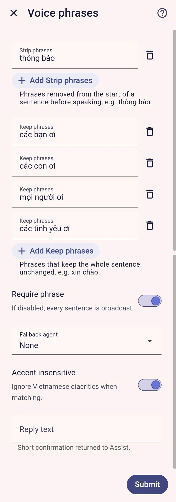
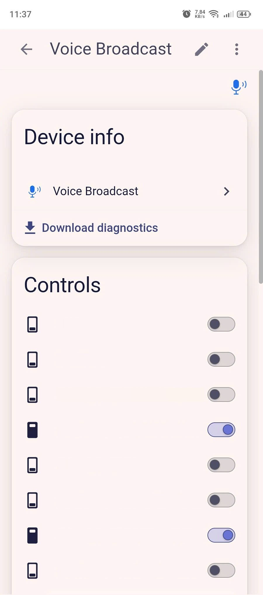
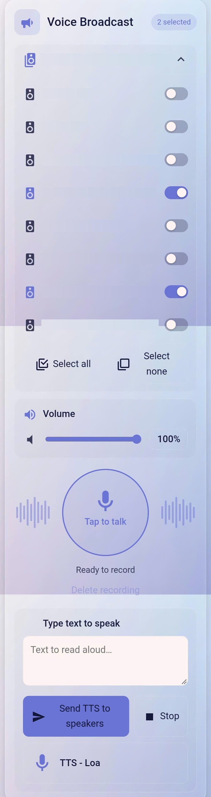
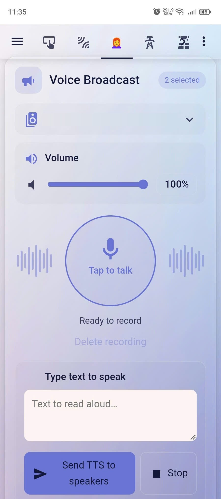

# Voice Broadcast

**English** | [Tiếng Việt](./README.vi.md)

[](https://my.home-assistant.io/redirect/hacs_repository/?owner=quangtienhn&repository=ha-voice-broadcast&category=integration)


Broadcast TTS announcements to multiple speakers and record short voice messages in the dashboard card to play on the selected speakers — local, no cloud dependency of its own.

> **Disclaimer:** Unofficial integration, not affiliated with or endorsed by Home Assistant, Nabu Casa, Tapo/TP-Link, or Google; provided as is. Based on the author's earlier private project TTS Broadcast.

## What it is and why

Voice Broadcast lets you announce a message on several speakers in one go. A common
use case is a Vietnamese smart-home announcement such as "thông báo, cơm chín rồi"
(dinner is ready). You configure one or more media-player speakers, choose which are
switched on, set a shared volume, and speak or type the message through Assist.

## Features and what it deliberately does not do

**Features**

- Announce one message to many speakers at once.
- Per-speaker on/off switches (only switched-on speakers play).
- Shared volume slider ("Initial volume" is only the starting value).
- Voice trigger through Assist: a sentence such as "thông báo {message}" is spoken
  only to the switched-on speakers.
- Custom dashboard card (`voice-broadcast-card`) with per-speaker switches, volume,
  message, Speak/Stop/Select buttons and a localized TALK (Assist) row.
- Voice relay: click Record in the card, speak, click Stop, and the clip is uploaded
  and played on the switched-on speakers. The audio is kept in a private temporary
  directory and deleted after playback.
- Read-only import of an existing TTS Broadcast configuration during first setup; the
  old entry is left untouched, so both integrations can run side by side.
- Services: `voice_broadcast.speak`, `voice_broadcast.stop`,
  `voice_broadcast.get_dashboard_card`, `voice_broadcast.debug_selection`.
- Fully local when you use a local TTS engine (e.g. Wyoming); the integration makes no
  cloud calls.

**Deliberately does not do**

- The TTS path does not stream your real voice: speech is converted to text and
  re-spoken by TTS. Only the separate voice relay sends recorded audio.
- No per-speaker volume (one shared volume).
- No custom frontend beyond the card, and no audio streaming between devices beyond
  the short relay upload.

## Documentation

- [Installation Guide (HACS & Manual)](./docs/INSTALL.md) | [Tiếng Việt](./docs/INSTALL.vi.md)
- [Dashboard Card Guide & Options](./docs/CARD.md) | [Tiếng Việt](./docs/CARD.vi.md)
- [Voice Relay & Audio Architecture](./docs/VOICE_RELAY.md) | [Tiếng Việt](./docs/VOICE_RELAY.vi.md)
- [HTTPS & Local Network Setup](./docs/HTTPS_LAN.md) | [Tiếng Việt](./docs/HTTPS_LAN.vi.md)
- [Troubleshooting & Runbook](./docs/TROUBLESHOOTING.md) | [Tiếng Việt](./docs/TROUBLESHOOTING.vi.md)
- [Migration from Predecessor](./MIGRATION.md) | [Tiếng Việt](./MIGRATION.vi.md)

## Requirements

- Home Assistant **2026.11.0 or newer** (the owner runs it on HAOS with HA 2026.11; older releases were not verified).
- A TTS entity (e.g. `tts.wyoming_vietnamese`).
- `media_player` speakers that can play TTS.
- Optional: an STT engine for voice trigger through Assist.
- For the voice relay: a browser on HTTPS or localhost (microphone access needs a
  secure context, or the Companion app), and an internal plain-HTTP LAN URL that the
  speakers can reach.

## Installation

### Manual installation

1. Copy `custom_components/voice_broadcast` into
   `config/custom_components/voice_broadcast`.
2. Restart Home Assistant.
3. Add the integration from Settings -> Devices & Services.

### HACS

1. HACS -> Integrations -> Custom repositories.
2. Add this repository URL, category "Integration".
3. Install "Voice Broadcast" and restart Home Assistant.
4. Add the integration from Settings -> Devices & Services.

## Configuration

Everything is configured from the UI (Settings -> Devices & Services -> Voice Broadcast
-> Configure).

| Field | Meaning | Example |
|-------|---------|---------|
| TTS entity | The TTS engine used to speak | `tts.wyoming_vietnamese` |
| Speakers | Media players that may announce | `media_player.living_room`, … |
| Speakers without volume control | Speakers excluded from `volume_set` | `media_player.porch` |
| Initial volume | Starting volume before the slider has a stored state | `50` |
| Language / options | Optional language/options passed to TTS | `vi` / `{}` |
| Strip phrases | Phrases removed from the start before speaking | `thông báo` |
| Keep phrases | Phrases that keep the whole sentence unchanged | `xin chào` |
| Require phrase | If disabled, every sentence is broadcast | enabled |
| Fallback agent | Assist agent used when no phrase matches | another conversation agent |
| Accent insensitive | Ignore Vietnamese diacritics when matching | enabled |
| Reply text | Short confirmation returned to Assist | `Đã gửi` |
| Maximum recording length | Relay recording limit, 5–60 seconds | `60` |

The options flow has three steps: **Speakers & TTS**, **Voice phrases**, and
**Recording** (the relay length limit).

Phrase examples: strip `thông báo` so "thông báo, cơm chín rồi" speaks only
"cơm chín rồi"; keep `xin chào` so "xin chào mọi người xuống ăn cơm" is spoken
whole.

The **Voice phrases** step of the options flow:



## Entities and services

One device "Voice Broadcast" with one switch per speaker, one shared volume number,
one message text, Speak/Stop/Select all/Select none buttons, and one conversation
agent.



Each announcement calls `tts.speak` once per selected speaker, in parallel: the TTS
engine synthesizes once per speaker (a little extra work) but a failing speaker never
blocks the others, and speakers may start a few milliseconds apart.

### `voice_broadcast.speak`

```yaml
service: voice_broadcast.speak
data:
  message: "Cơm chín rồi, mọi người xuống ăn!"
  speakers: ["media_player.living_room"]   # optional
  volume: 70                                # optional, 0-100
  language: vi                              # optional
  cache: false                              # optional
  audit: true                               # optional, wait for audit details
```

Response shape: `{played, skipped, failed, errors, targeted, unexpected_started,
context_id}`.

- `played`: speakers HA accepted the request for — **"accepted" does not mean
  audible**.
- `skipped`: unavailable/unknown speakers.
- `failed`: speakers that errored.
- `errors`: `{entity_id: short error text}`.
- `targeted`: the exact list sent to `tts.speak`.
- `unexpected_started`: media players that started playing but were not targeted
  (only filled when `audit: true`; otherwise see `debug_selection`/diagnostics).

### `voice_broadcast.stop`

```yaml
service: voice_broadcast.stop
data:
  speakers: ["media_player.living_room"]  # optional
```

### `voice_broadcast.get_dashboard_card`

```yaml
service: voice_broadcast.get_dashboard_card
data:
  notify: true
```

Returns a YAML snippet for a stock entities card (also creates a persistent
notification when `notify: true`).

### `voice_broadcast.debug_selection`

No side effects, no speech. Returns per-speaker state, the resolved list that a
`speak` without arguments would use, any media player listing a configured speaker
as a group member, and the last announcement audit. Use this to prove why extra
speakers play.

## Voice setup, step by step (read the pitfall first)

**Pitfall:** do not use the default Assist pipeline for the TALK button. The
default pipeline usually uses an LLM/Home Assistant conversation agent, and HA
will route the announcement to `assist_satellite.announce` on ALL Assist
satellites — so every speaker plays, not just the ones you switched on.

1. Settings -> Voice assistants -> Add assistant.
2. Choose conversation agent: **Voice Broadcast**.
3. Choose your STT engine and your TTS engine.
4. Save the pipeline. Do **not** make it the default pipeline.
5. Note its pipeline id.

In the dashboard card, set `assist_pipeline_id` to that id. Or leave it as
`auto` (the default): the card finds the pipeline whose conversation agent is the
Voice Broadcast agent automatically.

If no pipeline uses the Voice Broadcast agent, the TALK row is hidden and an info
line tells you to create one.

## Dashboard card

Add card -> Voice Broadcast. The card discovers the integration's entities
automatically.





Speaker names are redacted in these screenshots.

Card options (all optional):

| Option | Meaning | Default |
|--------|---------|---------|
| title | Card title | `Voice Broadcast` |
| show_volume | Show the volume slider | true |
| show_message | Show the message text | true |
| show_assist | Show the TALK (Assist) row | true |
| assist_pipeline_id | `auto`, `preferred`, `last_used`, or a concrete pipeline id | `auto` |
| assist_name | Override the TALK button label | `TALK` / `NÓI` |
| assist_icon | Override the TALK button icon | `mdi:microphone` |
| show_select_buttons | Show Select all / Select none | true |
| show_record | Show the voice relay (Record / Delete) row | true |
| max_record_seconds | Browser-side cap for the relay, 1–60; the server limit still wins | `60` |

YAML fallback (stock entities card):

```yaml
service: voice_broadcast.get_dashboard_card
data:
  notify: true
```

After install or update, hard-refresh the browser so the card JS is re-cached.

If no Assist pipeline uses the Voice Broadcast agent, no TALK row is rendered and a
localized info line is shown instead.

## Voice relay (record in the card)

The relay is a second way to get audio onto the speakers without TTS. It is useful for
a quick announcement in your own voice, a sound effect, or a language the TTS engine
handles badly.


1. Open a dashboard that contains the Voice Broadcast card. The page must be HTTPS or
   `localhost`; otherwise the card shows a localized explanation instead of asking for
   the microphone.
2. Click **Record** and allow microphone access. The card captures mono audio through
   an `AudioWorklet` (with a `ScriptProcessor` fallback), downsamples it to 16 kHz, and
   encodes a PCM WAV in the browser. Recording stops automatically at the configured
   limit.
3. Click **Stop recording**. The WAV is uploaded to Home Assistant and played on the
   speakers whose switches are on, at the current slider volume.
4. **Delete recording** discards the temporary file on the server immediately. The
   integration also deletes it after playback, after the timeout, on Stop, on unload,
   and on Home Assistant shutdown.

Limits and supported input:

| Item | Limit |
|------|-------|
| Upload size | 3 MiB |
| Duration | 60 seconds (hard limit); `max_record_seconds` can only lower it |
| Format | RIFF/WAVE, PCM, 16-bit, mono |
| Sample rate | 8–48 kHz (the card always sends 16 kHz) |
| Playback URL | internal plain-HTTP LAN URL only |
| Token lifetime | 120 seconds maximum |

The relay shares one announce lock with TTS. If an announcement is already running, the
upload returns HTTP 409 `{"ok": false, "error": "busy"}` and the card shows the busy
state; nothing is queued.

The recording is stored under `config/voice_broadcast_tmp/`, which is not a static
path and is not served by Home Assistant. Stale files are removed on startup and by a
30-second sweep.

### Relay HTTP API

| Method and path | Auth | Purpose |
|-----------------|------|---------|
| `POST /api/voice_broadcast/recording` | required | Raw WAV body; optional `?speakers=media_player.a,media_player.b` and `?volume=0-100` |
| `GET /api/voice_broadcast/recording/{token}.wav` | none | Speaker-facing download; token only, never a filesystem path |
| `DELETE /api/voice_broadcast/recording` | required | Discard every recording owned by the entry |
| `GET /api/voice_broadcast/config` | required | Return `version`, `max_record_seconds`, `max_bytes` for the card |

`POST` answers with `{"ok", "duration", "played", "skipped", "failed", "targeted",
"context_id"}`. Errors are short codes such as `too_large`, `bad_wav`, `unsupported_wav`,
`no_speaker`, `no_internal_url`, `busy`, `playback_failed`. Audio bytes, tokens and
recording contents are never logged.

## Migrating from TTS Broadcast

Voice Broadcast is a superset of the earlier TTS Broadcast integration, but it is a
different domain: entities, services and the card type change. During the transition
you can keep both installed.

- First setup offers **Import from TTS Broadcast** when a legacy `tts_broadcast` entry
  exists. It only reads that entry (speakers, TTS entity, volume, language, options,
  phrase settings) and fills the form; the old entry is not modified or removed.
- Add the new card (`custom:voice-broadcast-card`) to your dashboard, then remove the
  old one after you are happy.
- When you no longer need the old integration, remove its entry and folder manually.
- Both integrations can write to the same speakers, so do not leave two automations
  announcing the same message.

See `MIGRATION.md` (English) and `MIGRATION.vi.md` (Tiếng Việt) for the full checklist.

## Troubleshooting

| Problem | What to check |
|---------|---------------|
| All speakers play when I talk | You are using the default Assist pipeline (an LLM/Home Assistant agent routes to all satellites). Create a dedicated pipeline with conversation agent = Voice Broadcast and set `assist_pipeline_id` to its id. Use Developer Tools > Events > `call_service` to see who called `assist_satellite.announce` or `tts.speak`. |
| No microphone button | The pipeline needs an STT engine. The browser page must be HTTPS, or use the Home Assistant Companion app. The conversation entity's own chat dialog is text-only by design. |
| Some speakers quiet or silent | Check the volume slider and the speaker's own volume. Speakers in "Speakers without volume control" get no `volume_set`. Test the speaker directly with `voice_broadcast.speak`. |
| Extra speakers play | Call `voice_broadcast.debug_selection` and compare `targeted` vs `unexpected_started`. See the runbook below. |
| Card missing from picker | Hard-refresh the browser after install/update. |
| Configure error | Check the options error translation (e.g. "Select at least one speaker"). |
| Stop does not interrupt some ESPHome speakers | `media_player.media_stop` interruption on ESPHome announcement pipelines is unverified (see Known limitations). |
| Record button says a secure connection is required | Open Home Assistant over HTTPS, use `localhost`, or use the Companion app. Browsers block `getUserMedia` on plain HTTP origins. |
| Microphone permission denied / no microphone / microphone busy | Allow microphone access for the HA origin, check the OS privacy settings for the browser, and close other apps using the microphone. The card reports the specific case in EN/VI. |
| Relay says "no internal URL" | The speakers need a plain-HTTP LAN address. Set an internal URL in Settings -> System -> Network, or make sure Home Assistant detects a LAN IP and is not using HTTPS only. |
| Relay returns busy | A TTS announcement or another relay is still running. Wait for it to finish; the relay does not queue. |
| Relay plays only on some speakers | Expand the failed list on the card and check the integration log warning for those entity ids. A failing speaker never blocks the others. |
| Relay clip is silent or too quiet | Check the card volume and the speaker volume. `announce: true` uses the ESPHome announcement pipeline; some devices ignore the media volume for announcements. |

### Extra speakers play — runbook

1. Call `voice_broadcast.debug_selection` and read the output.
2. Turn exactly one switch ON, call `voice_broadcast.speak` with `return_response`,
   and compare `targeted` (exact list sent to `tts.speak`) with
   `unexpected_started`.
3. If `unexpected_started` is empty and `targeted` has one entity but other
   speakers still play, the cause is outside this integration: check the Logbook
   for who started those players, list automations/scripts that call
   `tts.speak` or `media_player.play_media`, and check for the old YAML package
   (script `old_broadcast_script`, the "Assist - old announcement" automation,
   `input_boolean.old_*`).
4. If `targeted` has more than one entity, send the full `debug_selection`
   output, the switch states, and the integration log lines.

## Known limitations and verification status

| Item | Status |
|------|--------|
| Per-speaker playback (one failing speaker never blocks others) | Verified by automated tests |
| `tts.speak` once per speaker, concurrently | Verified by automated tests |
| Volume slider as single source of truth | Verified by automated tests |
| `debug_selection` / audit / `unexpected_started` | Verified by automated tests |
| Card auto pipeline selection | Syntax-checked only (`node --check`); the selection logic is not unit-tested |
| WAV validation, upload auth, token paths, traversal rejection | Verified by automated tests |
| Relay playback selection, volume, per-speaker failure, cleanup | Verified by automated tests (mocked media players) |
| Relay concurrency (409 busy) and temp-dir sweep | Verified by automated tests |
| Browser recorder: downsample, WAV encoder, diagnostics | Verified by Node unit tests (not a real browser) |
| Coexistence with a legacy `tts_broadcast` entry and import step | Verified by automated tests with a stub legacy integration |

### Tested with (owner-confirmed on HAOS, Home Assistant 2026.11)

| Item | Status |
|------|--------|
| TTS to several ESPHome speaker media players | Tested and working |
| Wyoming TTS / STT | Tested and working |
| Per-speaker switches and shared volume | Tested and working |
| Voice phrases and the Assist pipeline with card `assist_pipeline_id: auto` | Tested and working |
| Dashboard card (0.2.x UI) | Tested and working |
| Voice relay recording from the Companion app | Tested and working |

### Not tested

| Item | Status |
|------|--------|
| Tapo camera speaker | Not tested |
| TTS engines other than Wyoming | Not tested |
| Other Home Assistant versions | Not tested (minimum declared 2026.11.0) |
| Docker / Core / Supervised installs | Not tested |
| iOS app | Not tested |
| Desktop browsers other than the one the owner used | Not tested |
| ESPHome announcement interruption via `media_stop` | Not tested |

## Privacy and security

- Message text is never logged at info level. Relay audio bytes, file paths and tokens
  are never logged either.
- No telemetry, no external calls from the integration.
- The relay upload and delete endpoints require authentication. The speaker-facing
  download endpoint is intentionally unauthenticated because ESPHome cannot send a
  bearer token; it accepts only a 43-character random token registered in memory, the
  file lives outside `www/`, and the token expires after 120 seconds.
- Anyone who can reach an Assist pipeline using the Voice Broadcast agent can speak
  on your speakers, and anyone with an active relay URL can fetch that one clip —
  protect your pipeline and network access.
- Not affiliated with or endorsed by Home Assistant, Nabu Casa, Tapo/TP-Link,
  Zalo, or Google.

## Development

```bash
ruff check .
ruff format --check .
pytest tests
node tests/test_card_display_name.mjs
node tests/test_card_recording.mjs
```

`hassfest` runs in CI (`.github/workflows/hassfest.yml`). See `CONTRIBUTING.md`,
`SECURITY.md`, `CODE_OF_CONDUCT.md`, and `TESTING.md`. The screenshots used in this
README are listed in `docs/images/README.md`.

License: MIT. See `LICENSE`.
