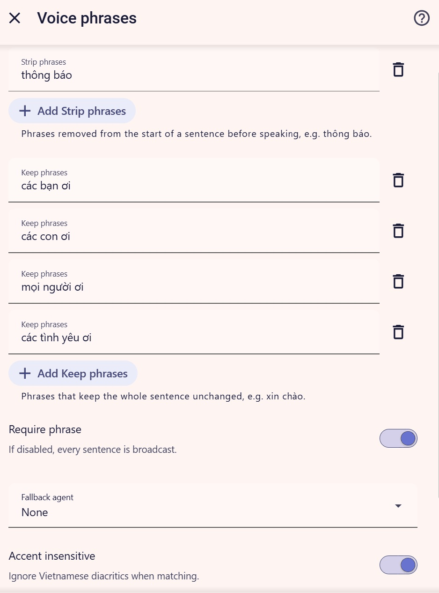
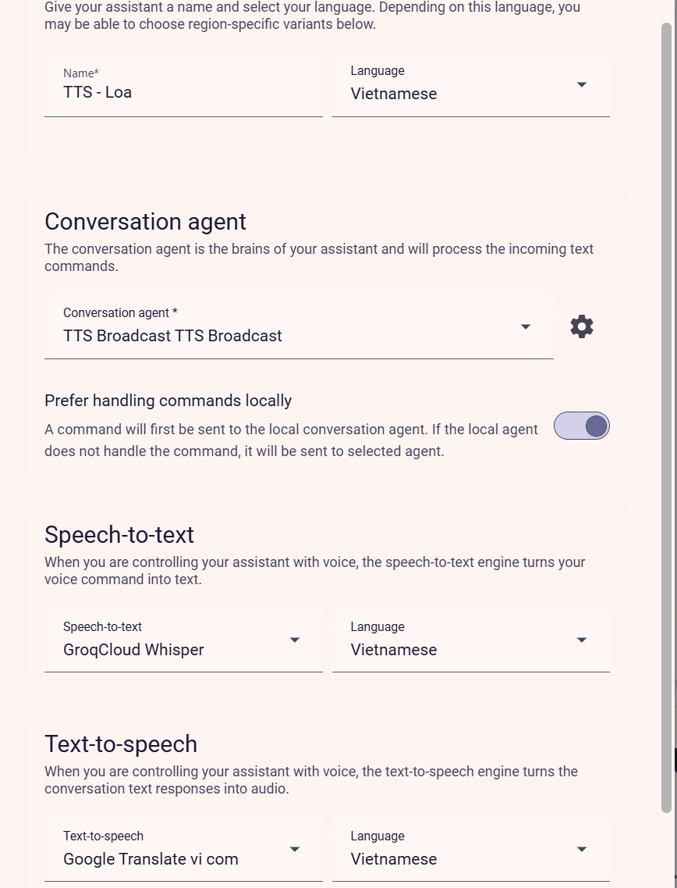
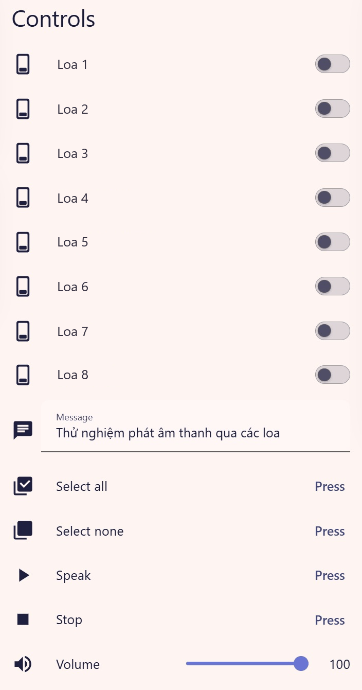

# Voice Broadcast

**[Tiếng Việt]** | **[English](./README.md)**

Một integration tùy chỉnh cho Home Assistant để phát thông báo TTS đến nhiều loa cùng
lúc, kèm tính năng chuyển tiếp giọng nói: ghi âm một đoạn ngắn ngay trên card
dashboard rồi phát trên các loa đã chọn. Chọn loa bằng công tắc, dùng chung một thanh
trượt âm lượng, kích hoạt bằng giọng nói qua Assist và điều khiển mọi thứ từ một card —
tất cả chạy cục bộ, bản thân integration không phụ thuộc dịch vụ đám mây nào.

> **Tuyên bố từ chối trách nhiệm:** Integration không chính thức, không liên kết hoặc được bảo trợ bởi Home Assistant, Nabu Casa, Tapo/TP-Link, hay Google; được cung cấp nguyên trạng. Dựa trên dự án riêng tư trước đây của tác giả là TTS Broadcast.

## Integration này là gì và vì sao nên dùng

Voice Broadcast giúp bạn đọc một thông báo trên nhiều loa cùng lúc. Ví dụ quen thuộc là
câu thông báo tiếng Việt "thông báo, cơm chín rồi". Bạn cấu hình một hoặc nhiều loa
`media_player`, chọn những loa đang bật, đặt âm lượng chung, rồi nói hoặc gõ tin nhắn
qua Assist.

## Các tính năng và những gì integration cố ý không làm

**Tính năng**

- Đọc một tin nhắn đến nhiều loa cùng lúc.
- Công tắc bật/tắt cho từng loa (chỉ loa đang bật mới phát).
- Thanh trượt âm lượng chung ("Âm lượng ban đầu" chỉ là giá trị khởi đầu trước khi
  thanh trượt có trạng thái đã lưu).
- Kích hoạt bằng giọng nói qua Assist: một câu như "thông báo {message}" chỉ được đọc
  trên những loa đang bật.
- Card dashboard tùy chỉnh (`voice-broadcast-card`) với công tắc từng loa, âm lượng, tin
  nhắn, các nút Phát/Dừng/Chọn tất cả/Bỏ chọn tất cả và hàng TALK (Assist) có nhãn và
  biểu tượng được bản địa hóa.
- Chuyển tiếp giọng nói: bấm Ghi âm trên card, nói, bấm Dừng ghi âm; đoạn âm thanh được
  tải lên và phát trên các loa đang bật. File được giữ trong thư mục tạm riêng tư và bị
  xóa sau khi phát.
- Nhập cấu hình TTS Broadcast cũ ở bước thiết lập đầu tiên (chỉ đọc); entry cũ không bị
  thay đổi, nên hai integration có thể chạy song song trong thời gian chuyển đổi.
- Dịch vụ: `voice_broadcast.speak`, `voice_broadcast.stop`,
  `voice_broadcast.get_dashboard_card`, `voice_broadcast.debug_selection`.
- Hoàn toàn cục bộ khi bạn dùng engine TTS cục bộ (ví dụ Wyoming); integration không gọi
  dịch vụ đám mây nào.

**Cố ý không làm**

- Luồng TTS không truyền giọng nói thật của bạn: giọng nói được chuyển thành văn bản rồi
  đọc lại bằng TTS. Chỉ tính năng chuyển tiếp giọng nói mới gửi âm thanh đã ghi.
- Không có âm lượng riêng cho từng loa (chỉ một âm lượng chung).
- Không có giao diện frontend tùy chỉnh nào ngoài card, và không truyền âm thanh trực
  tiếp giữa các thiết bị ngoài đoạn ghi âm ngắn của tính năng chuyển tiếp.

## Tài liệu chi tiết

- [Hướng dẫn cài đặt (HACS & Thủ công)](./docs/INSTALL.vi.md) | [English](./docs/INSTALL.md)
- [Hướng dẫn cấu hình Thẻ bảng điều khiển](./docs/CARD.vi.md) | [English](./docs/CARD.md)
- [Cơ chế Voice Relay & Xử lý âm thanh](./docs/VOICE_RELAY.vi.md) | [English](./docs/VOICE_RELAY.md)
- [Cấu hình mạng HTTPS & Mạng cục bộ (LAN)](./docs/HTTPS_LAN.vi.md) | [English](./docs/HTTPS_LAN.md)
- [Cẩm nang gỡ lỗi & Xử lý sự cố](./docs/TROUBLESHOOTING.vi.md) | [English](./docs/TROUBLESHOOTING.md)
- [Hướng dẫn chuyển đổi từ integration tiền nhiệm](./MIGRATION.vi.md) | [English](./MIGRATION.md)

## Yêu cầu

- Home Assistant **2026.11.0 trở lên** (dự án được xây và kiểm thử với HA 2026.10.4 và
  mã nguồn 2026.11.0; các bản cũ hơn chưa được kiểm tra cục bộ).
- Một TTS entity (ví dụ `tts.wyoming_vietnamese`).
- Các loa `media_player` có thể phát TTS.
- Không bắt buộc: một engine STT nếu bạn muốn kích hoạt bằng giọng nói qua Assist.
- Với tính năng chuyển tiếp giọng nói: trình duyệt chạy HTTPS hoặc localhost (quyền
  micro cần secure context, hoặc dùng ứng dụng Companion), và một URL LAN HTTP nội bộ
  mà các loa truy cập được.

## Cài đặt

### Cài thủ công (dùng được ngay; repository đang riêng tư)

1. Sao chép `custom_components/voice_broadcast` vào
   `config/custom_components/voice_broadcast`.
2. Khởi động lại Home Assistant.
3. Thêm integration từ Settings -> Devices & Services.

### HACS (chỉ sau khi repository được công khai)

1. HACS -> Integrations -> Custom repositories.
2. Thêm URL của repository này, chọn category "Integration".
3. Cài "Voice Broadcast" rồi khởi động lại Home Assistant.
4. Thêm integration từ Settings -> Devices & Services.

## Cấu hình

Toàn bộ cấu hình thực hiện trên giao diện (Settings -> Devices & Services -> Voice
Broadcast -> Configure).

| Trường | Ý nghĩa | Ví dụ |
|--------|---------|---------|
| TTS entity | Engine TTS dùng để đọc thông báo | `tts.wyoming_vietnamese` |
| Loa | Các loa `media_player` có thể phát thông báo | `media_player.phong_khach`, … |
| Loa không có điều khiển âm lượng | Các loa được loại trừ khỏi `volume_set` | `media_player.san_vuon` |
| Âm lượng ban đầu | Âm lượng khởi đầu trước khi thanh trượt có trạng thái đã lưu | `50` |
| Ngôn ngữ / Tùy chọn | Ngôn ngữ và tùy chọn (không bắt buộc) truyền cho TTS | `vi` / `{}` |
| Cụm từ bỏ đi | Cụm từ bị gỡ khỏi đầu câu trước khi phát | `thông báo` |
| Cụm từ giữ nguyên | Cụm từ giữ nguyên cả câu | `xin chào` |
| Bắt buộc cụm từ | Nếu tắt, mọi câu đều được phát | đã bật |
| Agent dự phòng | Agent Assist dùng khi không khớp cụm từ nào | một conversation agent khác |
| Không phân biệt dấu | Bỏ qua dấu tiếng Việt khi so khớp | đã bật |
| Văn bản trả lời | Câu xác nhận ngắn trả về Assist | `Đã gửi` |
| Thời lượng ghi tối đa | Giới hạn ghi âm của tính năng chuyển tiếp, 5–60 giây | `60` |

Luồng tùy chọn có ba bước: **Loa & TTS**, **Cụm từ thoại** và **Ghi âm** (giới hạn độ
dài bản ghi).

Ví dụ về cụm từ: bỏ đi `thông báo` nên "thông báo, cơm chín rồi" chỉ đọc "cơm chín
rồi"; giữ nguyên `xin chào` nên "xin chào mọi người xuống ăn cơm" được đọc nguyên câu.

Bước **Cụm từ thoại** trong luồng tùy chọn:



## Entity và dịch vụ

Một thiết bị "Voice Broadcast" gồm một công tắc cho mỗi loa, một entity number âm lượng
dùng chung, một ô tin nhắn, các nút Phát/Dừng/Chọn tất cả/Bỏ chọn tất cả và một
conversation agent.

Mỗi lần thông báo, integration gọi `tts.speak` một lần cho từng loa đã chọn, chạy song
song: engine TTS tổng hợp lại cho mỗi loa (tốn thêm một chút) nhưng một loa lỗi không
chặn các loa khác, và các loa có thể bắt đầu lệch nhau vài mili giây.

### `voice_broadcast.speak`

```yaml
service: voice_broadcast.speak
data:
  message: "Cơm chín rồi, mọi người xuống ăn!"
  speakers: ["media_player.phong_khach"]  # không bắt buộc
  volume: 70                               # không bắt buộc, 0-100
  language: vi                             # không bắt buộc
  cache: false                             # không bắt buộc
  audit: true                              # không bắt buộc, chờ kết quả kiểm tra
```

Cấu trúc phản hồi: `{played, skipped, failed, errors, targeted, unexpected_started,
context_id}`.

- `played`: các loa mà HA đã nhận yêu cầu — **"đã nhận" không có nghĩa là đã nghe
  thấy**.
- `skipped`: các loa không khả dụng hoặc không xác định được.
- `failed`: các loa bị lỗi.
- `errors`: `{entity_id: nội dung lỗi ngắn}`.
- `targeted`: danh sách chính xác được gửi tới `tts.speak`.
- `unexpected_started`: các loa `media_player` bắt đầu phát dù không nằm trong danh sách
  đích (chỉ được điền khi `audit: true`; nếu không, xem `debug_selection`/diagnostics).

### `voice_broadcast.stop`

```yaml
service: voice_broadcast.stop
data:
  speakers: ["media_player.phong_khach"]  # không bắt buộc
```

### `voice_broadcast.get_dashboard_card`

```yaml
service: voice_broadcast.get_dashboard_card
data:
  notify: true
```

Trả về một đoạn YAML cho card entities có sẵn (đồng thời tạo thông báo lâu dài khi
`notify: true`).

### `voice_broadcast.debug_selection`

Không có tác dụng phụ, không phát gì. Trả về trạng thái từng loa, danh sách đã giải
quyết mà một lệnh `speak` không tham số sẽ dùng, mọi `media_player` đang coi một loa đã
cấu hình là thành viên nhóm, và bản kiểm tra của lần thông báo gần nhất. Dùng lệnh này
để chứng minh vì sao có thêm loa phát.

## Thiết lập giọng nói, từng bước (đọc phần cảnh báo trước)

**Cảnh báo:** đừng dùng pipeline Assist mặc định cho nút TALK. Pipeline mặc định thường
dùng agent LLM/Home Assistant, và HA sẽ chuyển thông báo đến
`assist_satellite.announce` trên TẤT CẢ vệ tinh Assist — nên mọi loa đều phát, không chỉ
những loa bạn đã bật.

1. Settings -> Voice assistants -> Add assistant.
2. Chọn conversation agent: **Voice Broadcast**.
3. Chọn engine STT và engine TTS của bạn.
4. Lưu pipeline. **Không** đặt nó làm pipeline mặc định.
5. Ghi lại id của pipeline.



Trong card dashboard, đặt `assist_pipeline_id` thành id đó. Hoặc để `auto` (mặc định):
card sẽ tự tìm pipeline có conversation agent là Voice Broadcast.

Nếu không có pipeline nào dùng agent Voice Broadcast, hàng TALK sẽ bị ẩn và một dòng thông
báo đã bản địa hóa sẽ nhắc bạn tạo pipeline.

## Card dashboard

Thêm card -> Voice Broadcast. Card tự phát hiện các entity của integration.



Tên loa trong ảnh chụp màn hình là tên thay thế, không phải tên thật.

Tùy chọn của card (tất cả đều không bắt buộc):

| Tùy chọn | Ý nghĩa | Mặc định |
|--------|---------|---------|
| title | Tiêu đề card | `Voice Broadcast` |
| show_volume | Hiện thanh trượt âm lượng | true |
| show_message | Hiện ô tin nhắn | true |
| show_assist | Hiện hàng TALK (Assist) | true |
| assist_pipeline_id | `auto`, `preferred`, `last_used` hoặc id pipeline cụ thể | `auto` |
| assist_name | Ghi đè nhãn nút TALK | `TALK` / `NÓI` |
| assist_icon | Ghi đè biểu tượng nút TALK | `mdi:microphone` |
| show_select_buttons | Hiện các nút Chọn tất cả / Bỏ chọn tất cả | true |
| show_record | Hiện hàng chuyển tiếp giọng nói (Ghi âm / Xóa) | true |
| max_record_seconds | Giới hạn phía trình duyệt cho bản ghi, 1–60; giới hạn máy chủ vẫn được ưu tiên | `60` |

Phương án YAML dự phòng (card entities có sẵn):

```yaml
service: voice_broadcast.get_dashboard_card
data:
  notify: true
```

Sau khi cài đặt hoặc cập nhật, hãy tải lại trang (hard refresh) để trình duyệt nạp lại
JS của card.

Nếu không có pipeline Assist nào dùng agent Voice Broadcast, hàng TALK sẽ không được vẽ và
một dòng thông báo đã bản địa hóa sẽ hiện thay thế.

## Chuyển tiếp giọng nói (ghi âm trên card)

Đây là cách thứ hai để đưa âm thanh ra loa mà không cần TTS. Hữu ích khi bạn muốn thông
báo nhanh bằng chính giọng mình, phát một hiệu ứng âm thanh, hoặc dùng ngôn ngữ mà engine
TTS đọc chưa tốt.

1. Mở dashboard có card Voice Broadcast. Trang phải chạy HTTPS hoặc `localhost`; nếu
   không, card hiện giải thích đã bản địa hóa thay vì xin quyền micro.
2. Bấm **Ghi âm** và cho phép truy cập micro. Card thu âm mono qua `AudioWorklet` (có dự
   phòng `ScriptProcessor`), hạ mẫu xuống 16 kHz và mã hóa WAV PCM ngay trong trình duyệt.
   Bản ghi tự dừng ở giới hạn đã cấu hình.
3. Bấm **Dừng ghi âm**. File WAV được tải lên Home Assistant và phát trên các loa đang
   bật, ở âm lượng hiện tại của thanh trượt.
4. **Xóa bản ghi** hủy file tạm trên máy chủ ngay lập tức. Integration cũng tự xóa sau khi
   phát, khi hết thời gian chờ, khi bấm Dừng, khi gỡ entry và khi Home Assistant tắt.

Giới hạn và định dạng hỗ trợ:

| Mục | Giới hạn |
|-----|----------|
| Kích thước tải lên | 3 MiB |
| Thời lượng | 60 giây (giới hạn cứng); `max_record_seconds` chỉ có thể giảm |
| Định dạng | RIFF/WAVE, PCM, 16-bit, mono |
| Tần số lấy mẫu | 8–48 kHz (card luôn gửi 16 kHz) |
| URL phát | chỉ URL LAN HTTP nội bộ |
| Thời hạn token | tối đa 120 giây |

Tính năng chuyển tiếp dùng chung một khóa với TTS. Nếu đang có thông báo chạy, lần tải
lên trả HTTP 409 `{"ok": false, "error": "busy"}` và card hiện trạng thái bận; không có
hàng đợi.

Bản ghi nằm trong `config/voice_broadcast_tmp/`, không phải static path và không được
Home Assistant phục vụ. File cũ bị xóa khi khởi động và bởi tiến trình quét mỗi 30 giây.

### HTTP API của tính năng chuyển tiếp

| Phương thức và đường dẫn | Xác thực | Mục đích |
|--------------------------|----------|----------|
| `POST /api/voice_broadcast/recording` | bắt buộc | Body là WAV thô; có thể thêm `?speakers=media_player.a,media_player.b` và `?volume=0-100` |
| `GET /api/voice_broadcast/recording/{token}.wav` | không | Loa tải file; chỉ dùng token, không bao giờ dùng đường dẫn filesystem |
| `DELETE /api/voice_broadcast/recording` | bắt buộc | Hủy mọi bản ghi của entry |
| `GET /api/voice_broadcast/config` | bắt buộc | Trả `version`, `max_record_seconds`, `max_bytes` cho card |

`POST` trả `{"ok", "duration", "played", "skipped", "failed", "targeted",
"context_id"}`. Lỗi là mã ngắn như `too_large`, `bad_wav`, `unsupported_wav`,
`no_speaker`, `no_internal_url`, `busy`, `playback_failed`. Nội dung âm thanh, token và
bản ghi không bao giờ được ghi log.

## Chuyển từ TTS Broadcast

Voice Broadcast là bản mở rộng của integration TTS Broadcast trước đây, nhưng dùng domain
khác: entity, dịch vụ và loại card đều thay đổi. Trong thời gian chuyển đổi, bạn có thể
cài cả hai.

- Bước thiết lập đầu tiên sẽ mời **Nhập từ TTS Broadcast** nếu có entry `tts_broadcast`
  cũ. Bước này chỉ đọc entry đó (loa, TTS entity, âm lượng, ngôn ngữ, tùy chọn, cấu hình
  cụm từ) để điền sẵn form; entry cũ không bị sửa hay xóa.
- Thêm card mới (`custom:voice-broadcast-card`) vào dashboard, rồi gỡ card cũ sau khi đã
  hài lòng.
- Khi không cần integration cũ nữa, hãy xóa entry và thư mục của nó theo cách thủ công.
- Cả hai integration đều có thể điều khiển cùng một loa, nên đừng để hai automation cùng
  thông báo một nội dung.

Xem `MIGRATION.md` (tiếng Anh) và `MIGRATION.vi.md` (tiếng Việt) để có danh sách đầy đủ.

## Gỡ lỗi

| Vấn đề | Cần kiểm tra |
|--------|-------------|
| Tất cả loa đều phát khi tôi nói | Bạn đang dùng pipeline Assist mặc định (một agent LLM/Home Assistant chuyển thông báo đến mọi vệ tinh). Hãy tạo một pipeline riêng có conversation agent = Voice Broadcast và đặt `assist_pipeline_id` thành id của pipeline đó. Dùng Developer Tools > Events > `call_service` để xem ai đã gọi `assist_satellite.announce` hoặc `tts.speak`. |
| Không thấy nút micro | Pipeline cần một engine STT. Trang trình duyệt phải dùng HTTPS, hoặc dùng ứng dụng Home Assistant Companion. Hộp thoại chat riêng của conversation entity chỉ hỗ trợ văn bản, đây là thiết kế cố ý. |
| Một số loa phát nhỏ hoặc không phát | Kiểm tra thanh trượt âm lượng và âm lượng của chính loa. Các loa trong "Loa không có điều khiển âm lượng" không nhận `volume_set`. Thử phát trực tiếp trên loa bằng `voice_broadcast.speak`. |
| Có thêm loa phát | Gọi `voice_broadcast.debug_selection` và so sánh `targeted` với `unexpected_started`. Xem quy trình bên dưới. |
| Card không xuất hiện trong danh sách chọn | Tải lại trang (hard refresh) sau khi cài đặt/cập nhật. |
| Lỗi khi cấu hình | Kiểm tra bản dịch lỗi của phần tùy chọn (ví dụ "Chọn ít nhất một loa"). |
| Dừng không ngắt được phát trên một số loa ESPHome | Việc `media_player.media_stop` ngắt thông báo trên pipeline ESPHome chưa được kiểm tra (xem Giới hạn đã biết). |
| Nút Ghi âm báo cần kết nối bảo mật | Mở Home Assistant qua HTTPS, dùng `localhost`, hoặc dùng ứng dụng Companion. Trình duyệt chặn `getUserMedia` trên origin HTTP thường. |
| Bị từ chối quyền micro / không thấy micro / micro đang bận | Cấp quyền micro cho origin HA, kiểm tra quyền riêng tư của hệ điều hành cho trình duyệt và đóng ứng dụng khác đang dùng micro. Card báo đúng từng trường hợp bằng EN/VI. |
| Tính năng chuyển tiếp báo "no internal URL" | Loa cần một địa chỉ LAN HTTP thường. Đặt internal URL trong Settings -> System -> Network, hoặc bảo đảm HA nhận được IP LAN và không chỉ dùng HTTPS. |
| Tính năng chuyển tiếp trả busy | Đang có thông báo TTS hoặc một bản ghi khác chạy. Chờ xong; tính năng này không xếp hàng đợi. |
| Chỉ một số loa phát bản ghi | Mở danh sách lỗi trên card và xem cảnh báo trong log cho các entity đó. Một loa lỗi không chặn các loa khác. |
| Bản ghi im lặng hoặc quá nhỏ | Kiểm tra âm lượng trên card và trên loa. `announce: true` dùng pipeline thông báo của ESPHome; một số thiết bị bỏ qua âm lượng media khi thông báo. |

### Có thêm loa phát — quy trình xử lý

1. Gọi `voice_broadcast.debug_selection` và đọc kết quả.
2. Bật đúng một công tắc, gọi `voice_broadcast.speak` với `return_response`, rồi so sánh
   `targeted` (danh sách chính xác gửi tới `tts.speak`) với `unexpected_started`.
3. Nếu `unexpected_started` trống và `targeted` chỉ có một entity nhưng các loa khác vẫn
   phát, nguyên nhân nằm **ngoài integration này**: kiểm tra Logbook xem ai đã khởi động
   các loa đó, liệt kê các automation/script gọi `tts.speak` hoặc
   `media_player.play_media`, và kiểm tra gói YAML cũ (script `old_broadcast_script`, automation
   "Assist - old announcement", `input_boolean.old_*`).
4. Nếu `targeted` có nhiều hơn một entity, hãy gửi toàn bộ kết quả `debug_selection`,
   trạng thái các công tắc và các dòng log của integration.

## Giới hạn đã biết và tình trạng kiểm tra

| Mục | Trạng thái |
|------|-----------|
| Phát riêng từng loa (một loa lỗi không chặn các loa khác) | Đã kiểm chứng bằng kiểm thử tự động |
| Gọi `tts.speak` một lần cho mỗi loa, chạy song song | Đã kiểm chứng bằng kiểm thử tự động |
| Thanh trượt âm lượng là nguồn dữ liệu duy nhất | Đã kiểm chứng bằng kiểm thử tự động |
| `debug_selection` / kiểm tra / `unexpected_started` | Đã kiểm chứng bằng kiểm thử tự động |
| Card tự chọn pipeline Assist | Chỉ kiểm tra cú pháp (`node --check`); logic chọn pipeline chưa có unit test |
| Dòng HA 2026.11, loa `media_player` ESPHome | Đã kiểm chứng trên HA 2026.10.4 của tác giả |
| Pipeline Assist với TTS/STT Wyoming cục bộ | Đã kiểm chứng trên HA 2026.10.4 của tác giả |
| Hành vi loa Tapo | Chưa kiểm tra |
| Các engine TTS khác | Chưa kiểm tra |
| Các phiên bản HA khác | Chưa kiểm tra (khai báo tối thiểu 2026.11.0) |
| Ngắt thông báo ESPHome qua `media_stop` | Chưa kiểm tra |
| Trình chỉnh sửa trực quan trên frontend cho `assist_pipeline` | Chưa kiểm tra cục bộ (backend đã kiểm chứng) |
| Kiểm tra WAV, xác thực upload, token, chống path traversal | Đã kiểm chứng bằng kiểm thử tự động |
| Chọn loa, âm lượng, lỗi từng loa, dọn file của tính năng chuyển tiếp | Đã kiểm chứng bằng kiểm thử tự động (media player giả lập) |
| Xung đột (409 busy) và quét thư mục tạm | Đã kiểm chứng bằng kiểm thử tự động |
| Bộ ghi trong trình duyệt: hạ mẫu, mã hóa WAV, chẩn đoán | Đã kiểm chứng bằng unit test Node (không phải trình duyệt thật) |
| Chạy song song với entry `tts_broadcast` cũ và bước nhập cấu hình | Đã kiểm chứng bằng kiểm thử tự động với integration cũ giả lập |
| Ghi âm thật bằng micro + ứng dụng Companion trên điện thoại | Chưa kiểm tra — xem các bước thủ công trong `TESTING.md` |
| Tính năng chuyển tiếp trên loa ESPHome thật qua LAN | Chưa kiểm tra — xem `TESTING.md` |

## Quyền riêng tư và bảo mật

- Nội dung tin nhắn không bao giờ được ghi log ở mức info. Nội dung âm thanh, đường dẫn
  file và token của bản ghi cũng không bao giờ được ghi log.
- Không có telemetry, integration không thực hiện cuộc gọi mạng nào ra bên ngoài.
- Endpoint tải lên và xóa bản ghi yêu cầu xác thực. Endpoint tải file cho loa cố ý không
  yêu cầu xác thực vì ESPHome không gửi được bearer token; nó chỉ chấp nhận token ngẫu
  nhiên 43 ký tự đã đăng ký trong bộ nhớ, file nằm ngoài `www/`, và token hết hạn sau 120
  giây.
- Bất kỳ ai truy cập được pipeline Assist dùng agent Voice Broadcast đều có thể nói trên
  loa của bạn, và ai có URL bản ghi đang hiệu lực có thể tải đúng đoạn âm thanh đó — hãy
  bảo vệ pipeline và mạng của bạn.
- Không liên kết với và không được Home Assistant, Nabu Casa, Tapo/TP-Link, Zalo hay
  Google bảo trợ.

## Phát triển

```bash
ruff check .
ruff format --check .
pytest tests
node tests/test_card_display_name.mjs
node tests/test_card_recording.mjs
```

`hassfest` chạy trong CI (`.github/workflows/hassfest.yml`). Xem `CONTRIBUTING.md`,
`SECURITY.md`, `CODE_OF_CONDUCT.md` và `TESTING.md`. Các ảnh chụp màn hình dùng trong
README này được liệt kê tại `docs/images/README.md`.

Giấy phép: MIT. Xem `LICENSE`.
