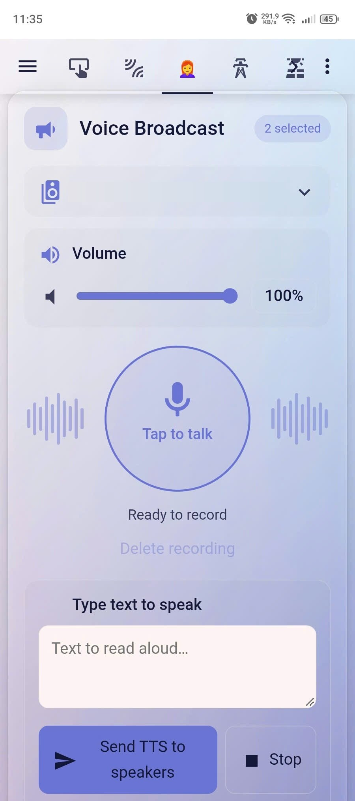

# Cơ chế Voice Relay & Xử lý âm thanh

[English](./VOICE_RELAY.md) | **Tiếng Việt**

Tính năng Voice Relay (Chuyển tiếp giọng nói) cho phép người dùng ghi âm giọng nói thật ngay trên thẻ bảng điều khiển và phát ngay lập tức tới các loa đã chọn mà không cần thông qua bộ đọc TTS.

---

## Thông số kỹ thuật & Giới hạn

- **Định dạng âm thanh**: Chuẩn RIFF/WAVE PCM mono 16-bit.
- **Thu âm phía client**: Trình duyệt thu âm qua `AudioWorklet` (tự động chuyển sang `ScriptProcessor` nếu không hỗ trợ), hạ mẫu xuống 16 kHz và đóng gói thành file WAV PCM hợp lệ.
- **Kích thước tối đa**: Tối đa 3 MiB (`MAX_BODY_BYTES = 3 * 1024 * 1024`).
- **Thời lượng tối đa**: Giới hạn cứng 60 giây; có thể điều chỉnh từ 5 đến 60 giây trong tùy chọn của tích hợp.
- **Lưu trữ tạm**: Lưu trong thư mục riêng `config/voice_broadcast_tmp/`. Thư mục này nằm ngoài `www/` và không bao giờ được cấu hình phục vụ file tĩnh trực tiếp.
- **Thời hạn Token**: Mỗi bản ghi được cấp một token ngẫu nhiên an toàn 43 ký tự với thời gian sống (TTL) 120 giây.

---

## Bảo mật & Kiến trúc

1. **Tải lên có xác thực (Upload)**:
   - Endpoint `POST /api/voice_broadcast/recording` yêu cầu xác thực người dùng Home Assistant (được xử lý tự động qua `hass.fetchWithAuth`).
   - Các yêu cầu không có xác thực sẽ bị từ chối với mã HTTP 401.

2. **Tải về cho loa không cần xác thực (Download)**:
   - Endpoint `GET /api/voice_broadcast/recording/{token}.wav` không yêu cầu xác thực vì các thiết bị loa nhúng (như ESPHome) không thể gửi kèm header Authorization khi lấy luồng âm thanh.
   - Token là chuỗi ngẫu nhiên mã hóa an toàn 32-byte (`secrets.token_urlsafe(32)`).
   - Chỉ các token đã đăng ký trong bộ nhớ và còn hạn mới được phản hồi; hệ thống không dùng token để ghép đường dẫn file trên ổ đĩa nên loại trừ hoàn toàn nguy cơ path traversal.

3. **Vòng đời & Tự động dọn dẹp file**:
   - File tạm được tự động xóa trong các trường hợp:
     - Khi tất cả các loa đích chuyển từ trạng thái đang phát/đang tải sang nghỉ/tắt.
     - Khi hết thời gian chờ an toàn (thời lượng ghi âm + 15 giây).
     - Khi bấm nút **Dừng** hoặc gọi dịch vụ `voice_broadcast.stop`.
     - Khi tải lại tích hợp hoặc khi Home Assistant tắt.
     - Khi khởi động Home Assistant (các file còn sót lại sẽ bị dọn sạch).
     - Quét định kỳ mỗi 30 giây để xóa các token và file quá hạn.
   - Nội dung âm thanh, đường dẫn file và token không bao giờ được ghi ra nhật ký (log).

4. **Kiểm soát xung đột (Busy locking)**:
   - Trong lúc một bản ghi đang phát trên loa, cờ `relay_playing` được đặt thành `True`.
   - Bất kỳ yêu cầu phát TTS hoặc tải lên bản ghi mới nào diễn ra trong thời điểm này sẽ nhận thông báo bận (HTTP 409 / lỗi `busy`).
   - Bấm **Dừng** sẽ dừng phát trên loa ngay, xóa file và mở lại trạng thái sẵn sàng (`relay_playing = False`).
